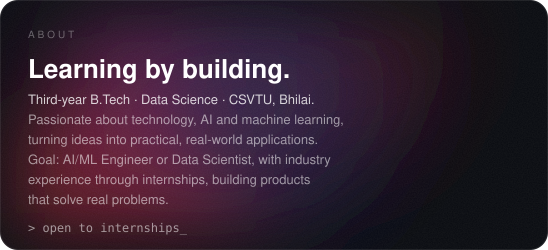

<table>
<tr>
<td valign="top"></td>
<td valign="top">
 

</td>
</tr>
</table>

<a href="https://github.com/AnuragVerma777/customer-churn-revenue-intelligence">customer-churn-revenue-intelligence</a> · <a href="https://github.com/AnuragVerma777/ResolveIQ">ResolveIQ</a> · <a href="https://github.com/AnuragVerma777/saansathi">saansathi</a> · <a href="https://github.com/AnuragVerma777/leetcode_solutions">leetcode_solutions</a> · <a href="https://github.com/AnuragVerma777/Game">Game</a> · <a href="https://github.com/AnuragVerma777/Hauntly">Hauntly</a>

 

